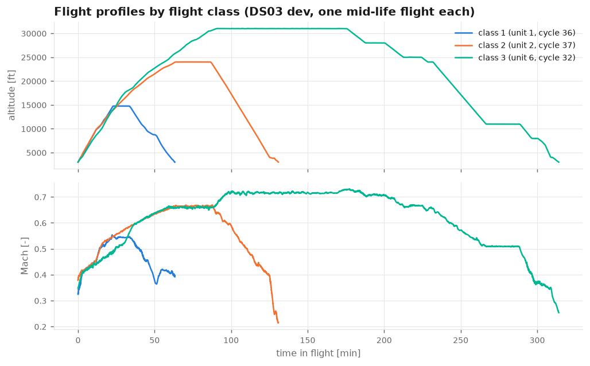
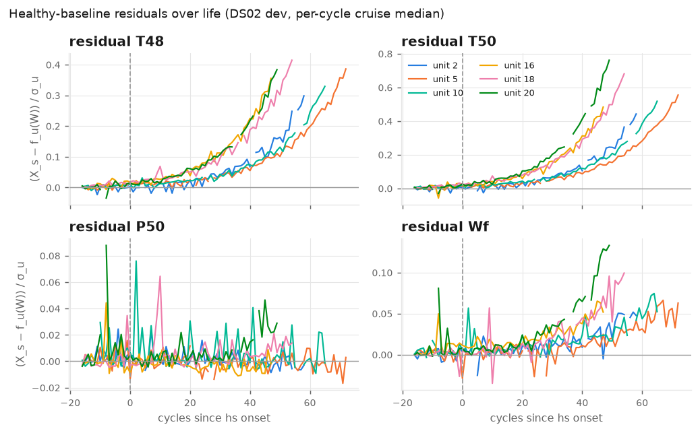

# AeroSentinel

> Uncertainty-aware remaining-useful-life (RUL) prediction and maintenance decision-making for turbofan engines, on NASA's N-CMAPSS dataset (simulated degradation under real recorded flight profiles), benchmarked first on the classic C-MAPSS.

**Status:** Phase 2 — N-CMAPSS data pipeline, EDA and a first LightGBM baseline on DS02 (Phase 1: C-MAPSS baselines). Deep models, conformal intervals, the maintenance policy, and the API/dashboard come in later phases (see [`docs/PHASES.md`](docs/PHASES.md)).

## Results at a glance

### C-MAPSS FD001–FD004 baselines (test set, last window per unit)

Every number below is generated by `scripts/make_tables.py` from `reports/results/*.json`. None is typed by hand.

<!-- results:cmapss:start -->
| Subset | Model | RMSE (capped) | Score Σ (capped) | MAE (capped) | RMSE (uncapped) | Score Σ (uncapped) |
|---|---|---:|---:|---:|---:|---:|
| FD001 | Constant | 40.48 ± 0.00 | 17604 ± 0 | 35.13 ± 0.00 | 41.82 ± 0.00 | 18062 ± 0 |
| FD001 | Ridge | 15.80 ± 0.00 | 427 ± 0 | 12.83 ± 0.00 | 17.08 ± 0.00 | 474 ± 0 |
| FD001 | LightGBM | **12.44 ± 0.27** | 243 ± 13 | 9.11 ± 0.22 | 13.74 ± 0.29 | 277 ± 13 |
| FD001 | 1D-CNN | 12.98 ± 0.32 | 309 ± 14 | 9.42 ± 0.35 | 14.23 ± 0.28 | 344 ± 13 |
| FD001 | LSTM | 13.65 ± 0.50 | 356 ± 13 | 10.15 ± 0.41 | 14.78 ± 0.59 | 387 ± 15 |
| FD002 | Constant | 43.45 ± 0.00 | 61324 ± 0 | 37.79 ± 0.00 | 53.79 ± 0.00 | 123779 ± 0 |
| FD002 | Ridge | 17.22 ± 0.00 | 1419 ± 0 | 13.86 ± 0.00 | 29.53 ± 0.00 | 13461 ± 0 |
| FD002 | LightGBM | 13.72 ± 0.07 | 826 ± 11 | 9.89 ± 0.04 | 26.60 ± 0.07 | 8061 ± 474 |
| FD002 | 1D-CNN | **13.38 ± 0.20** | 848 ± 37 | 9.56 ± 0.31 | 25.86 ± 0.15 | 6873 ± 26 |
| FD002 | LSTM | 14.49 ± 0.40 | 1242 ± 90 | 10.37 ± 0.18 | 26.55 ± 0.57 | 9478 ± 1745 |
| FD003 | Constant | 42.00 ± 0.00 | 38035 ± 0 | 35.32 ± 0.00 | 43.58 ± 0.00 | 38398 ± 0 |
| FD003 | Ridge | 16.81 ± 0.00 | 532 ± 0 | 13.97 ± 0.00 | 18.37 ± 0.00 | 592 ± 0 |
| FD003 | LightGBM | **12.90 ± 0.05** | 283 ± 3 | 9.05 ± 0.08 | 14.36 ± 0.06 | 320 ± 4 |
| FD003 | 1D-CNN | 14.21 ± 0.65 | 381 ± 15 | 11.17 ± 1.03 | 15.85 ± 0.94 | 430 ± 31 |
| FD003 | LSTM | 15.10 ± 1.49 | 474 ± 133 | 10.87 ± 1.24 | 16.53 ± 1.40 | 517 ± 133 |
| FD004 | Constant | 44.29 ± 0.00 | 106307 ± 0 | 37.78 ± 0.00 | 54.56 ± 0.00 | 141485 ± 0 |
| FD004 | Ridge | 19.35 ± 0.00 | 1812 ± 0 | 15.50 ± 0.00 | 30.58 ± 0.00 | 8317 ± 0 |
| FD004 | LightGBM | 15.03 ± 0.08 | 1065 ± 22 | 10.68 ± 0.05 | 27.36 ± 0.04 | 5240 ± 58 |
| FD004 | 1D-CNN | **14.25 ± 0.11** | 1111 ± 37 | 10.21 ± 0.06 | 26.25 ± 0.19 | 4376 ± 217 |
| FD004 | LSTM | 14.91 ± 0.07 | 1038 ± 26 | 10.85 ± 0.29 | 27.03 ± 0.10 | 5799 ± 803 |

Mean ± sample std over seeds 0, 1, 2 (all experiments). Lower is better everywhere; **bold** = best capped RMSE per subset. Score Σ = summed Saxena score with d = pred − true (late errors cost more).

Protocol: unit-level split (val = 20% of train-file units, fixed split seed); regime normalization and sensor selection (variance threshold, plus sensors with ≤ 2 distinct raw values in every regime) fit on train-split units only; window 30, stride 1; one prediction per test unit from its last window; train targets capped at 125. Units train/val/test: FD001 80/20/100 (0 padded), FD002 208/52/259 (6 padded), FD003 80/20/100 (0 padded), FD004 199/50/248 (11 padded). Test units shorter than the window are edge-padded by repeating their first cycle.

Constant and Ridge are deterministic, so their std over seeds is 0 by construction.
<!-- results:cmapss:end -->

**Capped vs uncapped truth.** All models train on RUL targets capped at 125 cycles, so they cannot predict more than 125. Some test units have true RUL above 125, so uncapped RMSE and score are expected to be worse. They are reported for comparability with papers that score against uncapped truth, not as the headline. **The capped columns are primary.**

**Phase 1 targets** (SPEC §3, capped test truth). These were stated up front as hypotheses. Per subset, the script picks the model with the lowest mean **validation** RMSE and then reports that model's test RMSE, so test numbers play no part in the choice. A target counts as met only if every seed meets it. If only the mean does, it is marked inconclusive:

<!-- results:cmapss-targets:start -->
| Target (capped test RMSE) | Model (picked on val) | Val RMSE | Test RMSE (capped) | Test RMSE per seed | Met? |
|---|---|---:|---:|---:|---|
| FD001 ≤ 13 | 1D-CNN | 11.41 ± 0.22 | 12.98 ± 0.32 | 13.01, 12.65, 13.28 | **inconclusive** (mean meets it; 1/3 seeds do) |
| FD004 ≤ 20 | 1D-CNN | 15.42 ± 0.12 | 14.25 ± 0.11 | 14.20, 14.38, 14.17 | yes |
<!-- results:cmapss-targets:end -->

**Findings (Phase 1).** This section only reads the tables above and the results JSONs; "previous run" means the JSONs at commit `6243933`, before the review fixes.

- **Targets.** The validation-picked model is the 1D-CNN on both subsets.
  - FD004 ≤ 20 is met on every seed.
  - FD001 ≤ 13 is **inconclusive**: the mean (12.98) meets it, but 2 of 3 seeds do not.
  - On FD001, LightGBM has the best test RMSE, but not the best validation RMSE, so it is not the pick (see the selection-bias note below).
  - The leakage alarm did not fire: no capped FD001 RMSE fell below 11 on any seed or model.
- **Quantized-sensor filter (review fix): hypothesis not confirmed.** I expected that dropping the quantized sensors would improve FD002/FD004. It did not: no FD002/FD004 capped RMSE moved by more than 0.08 from the previous run.
  - Only two of the four dropped sensors actually spiked after normalization: FD002 s10 (max |z| 56.8) and FD004 s16 (max |z| 42.9, on 4 rows).
  - FD001 s6 (7.4) and FD002 s16 (1.9) stay below the largest |z| of the kept sensors (8.3–8.7). These numbers come from train-split units, via `scripts/sensor_spikes.py` → `reports/results/cmapss-all_sensor-zmax_diag.json`.
  - On FD001, the only preprocessing change was dropping s6. With the same three seeds, LightGBM moved from 12.26 to 12.44 and the LSTM from 14.35 to 13.65. Each move is only 1–2 seed std, so it is not shown to hold beyond these seeds. FD003 had no sensor flagged, and its numbers reproduce the previous run to the reported precision.
- **Model ranking.**
  - On test, LightGBM is best on the single-condition subsets (FD001, FD003) and the 1D-CNN on the six-condition subsets (FD002, FD004).
  - The LSTM is never best. Its seed-to-seed std is the largest on FD001–FD003, but not on FD004.
  - Ridge on the flattened window beats the constant baseline by a wide margin and trails every nonlinear model. With the widened grid, its validation-picked α is inside the grid on every subset (10 to 1000). Validation RMSE is flat up to α = 1000 on FD001, FD002 and FD004 and rises above it. On FD003 it already rises at α = 1000.
- **Model selection on validation is biased, and noisy.**
  - The validation RMSE used for the pick was already optimized on the same validation units:
    - The neural nets keep the weights of their best epoch out of up to 100, so their reported validation RMSE is that minimum.
    - LightGBM picks its best boosting round on those units.
    - Ridge picks among 7 α values on them.
    - The bias is therefore optimistic, and by different amounts per model.
  - The validation metric also scores every window of each validation unit, while the test metric uses only the last window of each test unit.
  - FD001/FD003 have only 20 validation units.
  - On FD001, the neural nets score about 1.6 RMSE lower on validation than on test, against 0.2 for LightGBM. That is consistent with this bias and likely why the 1D-CNN, not LightGBM, is picked.
  - On FD002 and FD004, every non-constant model scores higher on validation than on test.
  - From Phase 3, model selection uses unit-level out-of-fold validation on last-window-truncated trajectories, which matches the test protocol (`docs/PHASES.md`).
- **Padded test units** (FD002: 6, FD004: 11; breakdown in each JSON under `test_capped_by_padding`). These groups are small, so their RMSE is noisy. On FD002, LightGBM does worse on padded units than on full-length ones, while the 1D-CNN and LSTM do better.
- **Budget note.** The FD001 1D-CNN ran 94, 100 and 96 epochs, so one seed hit the 100-epoch cap. Every other neural-net run early-stopped by epoch 74.

These are re-runs of simple baselines under one fixed protocol. Literature numbers use different protocols, so this is not a state-of-the-art comparison.

### N-CMAPSS DS02 — LightGBM baseline (test units 11, 14, 15, per cycle)

The first N-CMAPSS number. Details, data audits and figures are in [N-CMAPSS](#n-cmapss) below.

<!-- results:ncmapss:start -->
| Subset | Model | Setting | Inputs | Val RMSE (OOF) | **Test RMSE** | Test score (mean) | Test RMSE, cycles ≥ 6 | Test RMSE per window | Test RMSE uncapped | Test cycles scored / without window |
|---|---|---|---|---:|---:|---:|---:|---:|---:|---:|
| DS02 | LightGBM | full flight | W + X_s + residuals | 3.46 ± 0.05 | **4.39 ± 0.01** | 0.47 ± 0.00 | 4.39 ± 0.01 | 4.84 ± 0.01 | 6.89 ± 0.04 | 187 / 0 |
| DS02 | LightGBM | full flight | W + X_s | 4.23 ± 0.01 | 5.38 ± 0.04 | 0.58 ± 0.01 | 5.50 ± 0.04 | 5.62 ± 0.02 | 10.06 ± 0.06 | 202 / 0 |
| DS02 | LightGBM | cruise only | W + X_s + residuals | 3.71 ± 0.03 | 5.08 ± 0.02 | 0.57 ± 0.00 | 5.08 ± 0.02 | 5.17 ± 0.01 | 7.18 ± 0.03 | 141 / 46 |
| DS02 | LightGBM | cruise only | W + X_s | 5.44 ± 0.05 | 8.70 ± 0.05 | 1.03 ± 0.00 | 8.69 ± 0.05 | 7.18 ± 0.05 | 12.93 ± 0.05 | 151 / 51 |

Per test unit (per-cycle RMSE, capped truth):

| Setting | Inputs | unit 11 | unit 14 | unit 15 |
|---|---|---:|---:|---:|
| full flight | W + X_s + residuals | 5.05 ± 0.03 | 3.14 ± 0.02 | 4.96 ± 0.02 |
| full flight | W + X_s | 5.58 ± 0.01 | 6.09 ± 0.10 | 4.22 ± 0.05 |
| cruise only | W + X_s + residuals | 5.36 ± 0.01 | 3.61 ± 0.03 | 5.68 ± 0.03 |
| cruise only | W + X_s | 5.86 ± 0.06 | 13.70 ± 0.08 | 6.04 ± 0.07 |

Mean ± sample std over seeds 0, 1, 2. Per-cycle metrics (median of a cycle's window predictions) are primary; RMSE in cycles, lower is better; **bold** = best test RMSE. Score = mean Saxena score (d = pred − true). Truth capped at 48 unless marked uncapped. Windows: T = 64 model samples at downsample 10 (one sample every 10 s), stride 10 for every split. Val = out-of-fold per-cycle RMSE on the calibration unit of each of the 6 rotation folds (4 train / 1 early-stopping / 1 calib unit); the test prediction is the mean of the 6 fold models. Residual models are trained and scored from cycle 6 (their baseline uses cycles 1–5), so compare runs on the "cycles ≥ 6" column.
<!-- results:ncmapss:end -->

**Findings (Phase 2).** Each hypothesis was stated before the runs. Numbers come from the table above and `reports/results/ncmapss-ds02_*.json`. DS02 has 6 dev units and 3 test units, and the ± is seed-to-seed std only: it does not capture how much the numbers would move with other engines.

- **H1: healthy-baseline residuals drift with degradation. Supported for the turbine temperatures; not for P50.** These are per-cycle cruise medians, comparing the mean before hs onset with the mean of the last 5 cycles, in all 6 dev units:
  - T48 residuals rise from ≈ 0.00–0.01 σ to 0.27–0.36 σ.
  - T50 residuals rise from ≈ 0.00–0.02 σ to 0.40–0.67 σ.
  - Wf rises only to 0.05–0.12 σ, and P50 stays within ±0.03 σ.
  - Raw sensors show no visible trend, because flight conditions swamp them (see the raw-sensor figure).
  - In the figure, the drift becomes visible well after the hs onset, not at it. This is read off the figure; no script measures the delay.
- **H2: residual channels improve RUL. Supported on this split.** On cycles ≥ 6, where both inputs are scored on the same cycles, test per-cycle RMSE falls from 5.50 to 4.39 (full flight) and from 8.69 to 5.08 (cruise only). The out-of-fold validation RMSE falls too (4.23 → 3.46 and 5.44 → 3.71). Residual models early-stop after 50–400 rounds, while W + X_s models need thousands (best iterations in each run's `train_meta.json`).
- **H3: cruise-only windows beat full flights (CruiseBench's motivation). Not supported here.** Full flight is better for both input sets.
  - The comparison is not like for like. Cruise-only cannot score cycles whose cruise run is shorter than one window (46 of 187 residual-eligible test cycles, 33 of them on unit 14), and it sees only the plateau, not climb or descent.
  - It is also only LightGBM on 64-sample summaries. Phase 3 revisits it with sequence models.
- **H4: test units 14 and 15 (shorter, lower flights) are harder. Mixed.** The shift is real: median altitude is 23.0 kft on dev units, 11.4 kft on unit 14 and 18.9 kft on unit 15. Unit 14 also has the largest test W-extrapolation share (15.6 %).
  - Without residuals, unit 14 is the worst case (13.70 cruise only, 6.09 full flight).
  - With residuals, unit 14 is the *easiest* test unit (3.14 full flight). The per-engine baseline absorbs the flight-condition shift.
- **Other observations:**
  - Test error sits above out-of-fold validation error in every run (e.g. 4.39 vs 3.46).
  - Per-cycle aggregation (median over a cycle's windows) beats per-window error except for cruise only with W + X_s. There, per-cycle RMSE (8.70) is worse than per-window (7.18). One untested explanation: unit 14's short cruise runs give many cycles that each have only a few windows.
- **Budget change, made before any test evaluation:** the Phase 1 LightGBM setting (learning rate 0.02, cap 5000 rounds) stopped every W + X_s fold at the round cap with validation still improving. The four N-CMAPSS experiments use learning rate 0.05 and a 20 000-round cap; all folds now stop by early stopping. C-MAPSS is unchanged.
- **Not comparable with CruiseBench or other papers:** the cap is 48 rather than 34, windows are 64 samples at downsample 10 rather than 256 native samples, the model is LightGBM, and the split protocol is our own.

## Protocol (C-MAPSS)

- **Data:** NASA C-MAPSS (Saxena & Goebel 2008), downloaded from the primary NASA S3 URL by `scripts/download_data.py cmapss`. SHA256 checksums are in `configs/data_checksums.txt`.
- **Splits:** by engine unit only. Validation is 20% of the train-file units (fixed split seed 0, so every model sees the same units). The C-MAPSS loaders raise on the official test files (`test_*`, `RUL_*`) unless called with `allow_test=True`, which only `aerosentinel.evaluate` passes. `tests/test_test_guard.py` checks this. It is a guard against accidental use, not a hard barrier: code that opens the files directly with pandas or numpy is not stopped.
- **Labels:** piecewise-linear RUL, capped at 125 on training targets.
- **Preprocessing**, fit on train-split units only:
  - FD002/FD004: KMeans (k=6) on the three operating settings, then a per-regime z-score of every sensor. FD001/FD003: a global z-score.
  - Then sensor selection, with two rules:
    - a variance threshold on the normalized sensors. After a per-regime z-score every non-constant sensor has variance ≈1, so this only drops sensors that are constant within every regime;
    - drop sensors with **≤ 2 distinct raw values within every regime**. These quantized sensors (FD001 s6, FD002 s10/s16, FD004 s16) pass the variance rule. For two of them, FD002 s10 and FD004 s16, the z-score turns a flip between levels into a spike of tens of σ (see the Findings).
  - The kept and dropped sensors are recorded in every results JSON.
- **Inputs:** regime-normalized sensors only. LightGBM also gets the regime id. Unit, cycle, the raw settings and RUL never reach a model, and `tests/test_features_no_leak.py` enforces this.
- **Windows:** length 30 and stride 1, using a window index over per-unit arrays (nothing is materialized).
  - Test scoring uses the last window of each test unit.
  - Test units with fewer than 30 cycles (some FD002/FD004 units) are **edge-padded by repeating their first cycle**. Training uses only full windows.
- **Models:**
  - Constant: the train-split mean of the capped RUL labels.
  - Ridge: on the flattened window, with α picked on validation units from {0.1, 1, 10, 100, 10³, 10⁴, 10⁵}.
  - LightGBM: last/mean/std/slope/min/max of each sensor, plus the regime id.
  - 1D-CNN: Li et al. 2018 style.
  - LSTM: 2 × 64.
  - All hyperparameters were fixed before the first test evaluation (commit `6243933`). **The test set has since been scored a second time.** After a review of that first run, two changes were made: the ≤ 2-distinct-values sensor rule, and the ridge α grid, widened from {0.1…100} to {0.1…10⁵} because α sat on its upper edge. Everything was then retrained and re-scored. These changes came from review findings (input spikes and α at the grid edge), not from tuning on test RMSE, but the reported numbers are from the second look at the test set.
  - The neural nets use AdamW, a cosine schedule, and early stopping on validation RMSE (SPEC §5.3).
- **Metrics:** RMSE, MAE, and the Saxena asymmetric score with d = pred − true, summed for C-MAPSS. All are reported as mean ± sample std over seeds 0, 1, 2.
- **Leakage alarm:** a capped FD001 RMSE below 11 on any seed makes `evaluate` exit non-zero (SPEC §3).

## N-CMAPSS

NASA N-CMAPSS: the CMAPSS engine model driven by real recorded flights (climb, cruise, descent) at 1 Hz, with run-to-failure trajectories per engine unit. Phase 2 builds the data pipeline on DS02 (6 dev units, test units 11, 14, 15) and extracts DS01–DS07 for later pooling.

### Pipeline (Phase 2)

- **Download** (`scripts/download_data.py ncmapss`): HEAD Content-Length check, free-disk check, resumable download, then stream extraction of DS01–DS07 through the nested `data_set.zip` without writing it to disk (Python `zipfile`, members in offset order). SHA256 and size of the archive and of each `.h5` are in [`configs/data_checksums.txt`](configs/data_checksums.txt).
  - **Deviation from SPEC §1.2 step 6:** the 15.8 GB archive was kept (`--keep-zip`), by decision, so DS08 can be extracted later without a second download.
- **Store** (`scripts/prepare_ncmapss.py`): each unit becomes contiguous float32 `.npy` arrays (W, X_s, Y, A, memory-mapped) plus a flight table. X_v and theta are never converted. Windows are never stored: a window index of integers `(unit, cycle, start)`, cached by config hash, slices the arrays on the fly.
- **Cruise mask** (`aerosentinel.data.masks`, our own design): rolling-median altitude, then the longest run that is high (above the flight's mid-altitude) and stable (smoothed altitude within ±50 ft over 61 s), at least 512 samples long, with raw altitude std < 50 ft. Windows lie inside that one run; separate cruise runs are never spliced. The comparison with CruiseBench's released mask is below and in [this figure](reports/figures/ncmapss_mask_vs_cruisebench.png) (the 3 flights where the masks differ most).
- **Healthy-baseline residuals** (`aerosentinel.data.baseline_residuals`): per engine, a small MLP W → X_s fit on **that engine's own first 5 cycles** (no hs, no labels, no other engine), giving 14 residual channels `(X_s − f_u(W)) / σ_u`. Models that use them are trained and scored from cycle 6.
- **Windows:** T = 64 model samples at downsample 10 (10.7 min of flight), stride 10, one stride for every split, never crossing a (unit, cycle) boundary or a cruise-run edge. T was fixed by a rule set before any model was trained (table below).
- **RUL cap: 48 for DS02, hs-derived, not SPEC's 34.** CruiseBench's η = 5 % caps match SPEC for all nine subsets, and each is below our hs-derived minimum, so nothing contradicts them. But neither CruiseBench branch says how η turns into a cap, and its η = 0 caps do not reproduce from the dev units' health state (table below). Under the rule agreed for this phase (an ambiguous definition means using caps we can derive ourselves), every N-CMAPSS cap is the minimum number of abnormal (hs = 0) cycles over a subset's dev units. For DS02 that is 48, from dev unit 16. Results are therefore not comparable with CruiseBench's capped numbers.
- **Flight classes:** every DS02 dev unit is class 3 (> 5 h flights), so leave-one-flight-class-out (Phase 3) will run on DS03. SPEC §5.5 expected equal units per class in DS03; the dev split actually has 3 / 4 / 2.

### Figures





More: [raw sensors over life](reports/figures/ncmapss_sensors_over_life.png), [hs onset per unit](reports/figures/ncmapss_hs_onset.png), [altitude, dev vs test units 14/15](reports/figures/ncmapss_altitude_dev_vs_test.png), [mask vs CruiseBench](reports/figures/ncmapss_mask_vs_cruisebench.png). All are drawn by `scripts/make_eda_figures.py` (`check_caps.py` for the mask), with the cited numbers in `reports/results/ncmapss-ds02_data_eda.json`.

### Data audits

Generated from `reports/results/ncmapss-*_data_*.json`:

<!-- results:ncmapss-data:start -->
**Flight classes (dev units).** DS02: class 1: 0, class 2: 0, class 3: 6; DS03: class 1: 3, class 2: 4, class 3: 2. Leave-one-flight-class-out will run on **DS03** (rule: every class needs ≥ 2 dev units).

**RUL caps.** CruiseBench commit `ef26d40fe0`. Caps used: **hs-derived** — CruiseBench's η=5% caps match SPEC but its cap definition is not stated (ambiguous), so per the agreed rule the hs-derived dev-unit caps are used.

| Subset | SPEC (η = 5 %) | CruiseBench η = 5 % | CruiseBench η = 0 % | hs-derived (dev min abnormal cycles) | Used |
|---|---:|---:|---:|---:|---:|
| DS01 | 38 | 38 | 46 | 57 | 57 |
| DS02 | 34 | 34 | 41 | 48 | 48 |
| DS03 | 34 | 34 | 41 | 36 | 36 |
| DS04 | 43 | 43 | 52 | 54 | 54 |
| DS05 | 38 | 38 | 46 | 40 | 40 |
| DS06 | 41 | 41 | 50 | 42 | 42 |
| DS07 | 39 | 39 | 47 | 44 | 44 |

**Cruise mask vs CruiseBench** (DS02 dev, 446 flights): per-flight IoU median 0.987, mean 0.951, 10th percentile 0.971, min 0.000; 96% of flights ≥ 0.9. Flights with a cruise run: ours 432, CruiseBench 444. Mean run length where both accept: ours 68 min, CruiseBench 68 min.

**Cycles with ≥ 1 window** (DS02 dev, all cycles). Rule: largest T in [64, 128, 256] with >= 95% of dev cycles having >= 1 window in cruise_only at downsample 10 → **T = 64**.

| Setting | Downsample | T = 64 | T = 128 | T = 256 |
|---|---:|---:|---:|---:|
| full_flight | 1 | 100.0% | 100.0% | 100.0% |
| full_flight | 10 | 100.0% | 100.0% | 100.0% |
| cruise_only | 1 | 96.9% | 96.9% | 96.9% |
| cruise_only | 10 | 96.4% | 93.3% | 71.3% |

**W-extrapolation share** (rows after cycle 5 whose flight descriptors leave the range seen in the engine's own cycles 1–5; the risk of the healthy baseline): dev: 2 1.9%, 5 20.9%, 10 7.9%, 16 5.5%, 18 3.4%, 20 8.9%; test: 11 4.4%, 14 15.6%, 15 10.9%.
<!-- results:ncmapss-data:end -->

## Quickstart

```bash
make setup                                    # uv sync (CPU-only torch)
make data-cmapss                              # download + checksum C-MAPSS into data/raw/
uv run python scripts/run_cmapss_baselines.py # train 20 experiments × 3 seeds, evaluate, rebuild tables
make test                                     # fast tests
```

N-CMAPSS (Phase 2; ~16 GB download, ~21 GB of `.h5`, ~10 min extraction):

```bash
make data-ncmapss                                        # download, stream-extract DS01–DS07, checksums
uv run python scripts/prepare_ncmapss.py --datasets DS02 # per-unit arrays, cruise runs, baselines
uv run python scripts/audit_flight_classes.py            # Fc audit
git clone --depth 1 https://github.com/NostalgiaJohn/CruiseBench /tmp/cruisebench
uv run python scripts/check_caps.py --cruisebench /tmp/cruisebench   # caps + mask comparison
uv run python scripts/window_coverage.py                 # cycles with >= 1 window, fixes T
uv run python scripts/make_eda_figures.py                # reports/figures/ncmapss_*.png
uv run python scripts/run_ncmapss_baselines.py           # 4 LightGBM experiments x 3 seeds
```

Run a single experiment with `make train EXP=cmapss-fd001_lgbm_cap125`, then `uv run python -m aerosentinel.evaluate experiment=cmapss-fd001_lgbm_cap125`.

## Citation

A. Saxena and K. Goebel (2008). "Turbofan Engine Degradation Simulation Data Set", NASA Prognostics Data Repository, NASA Ames Research Center, Moffett Field, CA.

M. Arias Chao, C. Kulkarni, K. Goebel, O. Fink (2021). "Aircraft Engine Run-to-Failure Dataset under Real Flight Conditions for Prognostics and Diagnostics." *Data* 6(1):5. doi:10.3390/data6010005.

CruiseBench and its released cruise mask (CPM-N-CMAPSS): github.com/NostalgiaJohn/CruiseBench (checked at commit `ef26d40`). Used only to compare caps and the cruise mask; none of its code is used here.
